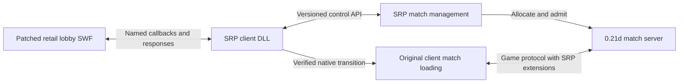

<!-- SPDX-License-Identifier: GPL-3.0-or-later -->
# Survarium 0.21d Scaleform match menu plan

Plan dated 2026-10-11. Milestones 1–5 have partial implementation and runtime evidence; see
[`client/021d/README.md`](../../client/021d/README.md) for implementation and
validation status. Native session lookup and room controls have also passed
in the real lobby through an isolated login/lobby fixture, with preview off.
The stock Escape integration is patched and runtime-tested. Two clean-retail
clients have now created/joined/readied/started one real match through the menu
and our isolated allocation service. The creator returned to the browser while
the other player kept firing; the last return released the server and grants.
The joining client's retained-room refresh is fixed and runtime-tested. A
movement/firing run compared 1,186 same-time simulation hashes without mismatch.
Bounded populated-history export now captures real animation/world data locally;
two samples also pass byte-identical decode/resource-fixup/reserialize tests in
temporary histories inside a loaded game. Applying that state to a live world
and catching up an already-loaded second client subsequently passed through
an isolated adaptation of the current server, with 1,144 matching post-restore
hash pairs. Late joining and reconnect still need retail-client validation.
Our `SRP1` upload uses `0x48` and
preserves stock Leave on `0x47`. Combat/recovery, late joining, remote accounts,
failure cases and release deliverables remain open; this is not completion of
the gates below.

The native UI now reuses the original Ranking frame and replaces Play with
Matches. Waiting-room disconnect and service-shutdown cleanup pass real-socket
tests. Client packaging now includes the archive-tool source and independent
Cargo.lock; `prepare_client.py` builds a verified local payload and patch
manifest from retail inputs. The installer now stages and verifies replacements,
retains originals and restores after interrupted operations. Remote service
configuration, Windows packaging, patch composition and the remaining gameplay
gates are open.

`launch_client.py` now verifies an installed package and uses one profile for
local login/menu endpoints and native/Wine runtime settings. A real packaged
client passed login, Create/Ready/Start, stock Leave, browser return and normal
exit through that launcher. Installation and Wine-prefix locks remain held
until the client exits. Remote hosting remains a separate integration step.

The allocator now retrieves generation-bound native results before final-player
cleanup. A real packaged-client run reached the stock statistics screen after
a time-limited match using a second admission order in the same session. The
adapter now covers both recovery and final-statistics snapshot requests; its
51 server tests check the SRP envelope on received requests. The UI now shows
a native-styled explanation after 15 seconds without results. Real-client
fault tests verify Close, another match's fresh timer, and recovery when late
statistics arrive. Multi-player and combat results, objective victory and
the other release gates still need validation/implementation.

The server now exposes SRP1 directly. The menu allocator explicitly selects
and verifies that mode; temporary server source rewriting is retired. The
integrated server passes 56 tests and the updated menu lifecycle test verifies
the corrected native ping opcode. Running-match admission still needs a
generation-bound grant/slot interface: current grants and descriptors are
fixed at server startup. See the late-admission boundary in
`client/021d/docs/running-match-research.md`. The server worker records the
user's combat acceptance; additional telemetry alone does not require another
combat playtest.

Extend the original 0.21d lobby SWF so players can browse, create, join, and
leave matches hosted by our own server. Ship our launcher, client DLL, asset
patch tooling, server changes, and build instructions as open source. Target
clean retail build 2010 plus explicitly identified SRP patches. The community
client is research evidence, not an installation prerequisite or compatibility
target.

The preferred implementation is a small x86 DLL that connects the existing
Scaleform interface to a versioned match-management service. Keep the original
renderer, UI assets, and game loading machinery. Prove the movie-to-DLL round
trip before building the complete menu or coupling it to the match server.

## Player experience

Replace the existing Play button with Matches, retaining its location and skin.
Use the original Ranking window frame, embedded fonts and native controls for
the browser, creation form and waiting room.
Opening it shows available matches, with name, map, mode, occupancy, and state.
Provide Refresh, Join, and Create controls, a clear empty state, and readable
connection errors. Only show latency if we actually measure it.

Create opens a dialog with match name, map, game mode, player limit, and the
supported duration settings. Populate options from the server's capabilities
and the client's installed content. The creator enters a waiting room showing
the roster, ready state, Leave, and a creator-only Start button. Starting is
permitted only when the server's minimum-player and readiness rules pass.

Joining a waiting match enters the same room. Joining an active match is offered
only when the server supports and has validated late joining. Otherwise explain
why Join is unavailable. Both flows use the normal game loading screen. Leaving
or finishing returns to a usable lobby where another match can be selected.

Assumption: Create allocates a match on the configured SRP server. Starting a
server process on the player's PC, NAT traversal, and worldwide discovery are
separate features. The release includes instructions for running one's own SRP
server and configuring the client to use it.

## Verified starting points

The original `flash_movies/lobby_menu.swf` is available in the archived 0.21d
resources and as an extracted research copy. Its header is CWS version 21;
the compressed file is 16,529,440 bytes and decompresses to its declared
18,341,214 bytes. Its ABC contains ActionScript 3 classes, CLIK components,
and `ExternalInterface` references.

The inspected ABC method inventory supplies these reuse candidates:

| Existing interface | Planned use |
| --- | --- |
| `StatusPanel`, `ButtonClickPlay`, lists and dialog components | Match entry, browser rows and creation form |
| `LobbyMenu.has_active_window`, `close_active_window`, `is_typing` | Modal focus, Escape and text input integration |
| `show_match_making`, `switch_mm_to_loading`, `set_mm_level` | Existing loading presentation |
| `set_mm_players`, `add_mm_player`, `remove_mm_player` | Existing roster presentation where its data contract fits |
| `show_system_message`, `set_localization_data` | Errors and translated labels |
| `survarium.gsearch.LobbyGameSearch` and `LobbyGameLoad` | Queue/loading controls, not evidence of a ready-made match browser |

These are inventory findings, not proof that arbitrary new screens can already
be instantiated. Inspect their constructors, display-list dependencies and
native argument shapes in the first milestone.

The matching retail PDB index identifies these native anchors. Addresses are
for the verified executable below, with preferred image base `0x10000`.

| Function | RVA | Preferred VA |
| --- | --- | --- |
| `lobby_menu::scaleform_callback` | `0x1615c8` | `0x1715c8` |
| `lobby_menu::tick` | `0x15ef7a` | `0x16ef7a` |
| `flash_external_handler_impl::Callback` | `0x1a576e` | `0x1b576e` |
| `flash_movie::SetExternalInterface` | `0x1a57ae` | `0x1b57ae` |
| `lobby_client::set_status_ready_for_match` | `0x18d4d6` | `0x19d4d6` |
| `network_client::close_current_match` | `0x1923b8` | `0x1a23b8` |

These are symbol-derived candidates; instruction boundaries, calling
conventions, object lifetimes and thread ownership still need validation.
The older reconstructed `lobby_menu_external_handler::callback` is a useful
reference but is not the 0.21d hook contract.

The existing SRP `browser-server` serves `/hello` with a lobby address. It has
no match registry. The existing lobby's ReadyForMatch branch returns a fixed
match ID. Neither establishes 0.21d compatibility or implements this feature.

## Client architecture

### DLL loading and hooks

Build `srp-client-021d.dll` as a 32-bit native module. Start with a minimal
open-source launcher that launches the selected game and loads our DLL into
that process early enough for UI initialization. Test this method on Windows
and Wine. If it proves unreliable, use a small, reversible loader/import patch
to load the same DLL. Keep the feature implementation in the DLL in either case.

Initialization must occur outside loader-lock-sensitive `DllMain` work. Resolve
hooks by validated build identity and module-relative addresses. Check expected
instructions before installing each hook; account for relocated instructions,
register preservation and calling conventions. Unknown builds must fail with
an actionable message rather than applying guessed offsets.

Prefer interception of the lobby's own Scaleform callback. Reserve an `srp_`
prefix for our commands and forward all original commands untouched. Add a
per-frame completion drain at a verified UI-thread point. Network work runs
asynchronously; only the UI thread accesses Scaleform values or invokes movie
methods. Copy request values before returning from callbacks. Invalidate pending
responses when the movie is destroyed, the user signs out, or its generation
changes. Avoid passing allocator-owned C++ objects across incompatible runtimes.

Use the game's existing Scaleform runtime and narrow recovered ABI declarations.
The public client build should not require rebuilding or bundling the local
proprietary GFx SDK. Establish the exact value ownership and invocation ABI in
the initial proof; local SDK/reconstruction files are references, not portable
binary interfaces by assumption.

### SWF changes and packaging

Patch the original lobby movie, preserving its timeline, exports, embedded art,
fonts and existing functions. Add the new ActionScript classes and glue needed
to compose screens from its components. Keep all new ActionScript and patch
recipes in source control.

Evaluate a pinned open-source SWF/ABC editor/compiler path with an unchanged
round trip and then a single button addition. No suitable editor/compiler was
found on the current shell PATH; reproducible provisioning is part of the
first milestone. Select the tool after proving it preserves this movie and
its Scaleform extensions. Do not depend on manual edits in a Flash authoring UI.

Extract the user's SWF, validate its hash, transform it, then replace that member
through the existing resources-db reader/packer. New movie size may differ;
rebuild the archive index instead of overwriting an assumed fixed byte range.
Verify the resulting member and unchanged members by content hashes. A loose
file or small overlay archive is preferable only if 0.21d mount precedence is
demonstrated; it is not currently an established installation method.

Compose asset and executable modifications through a manifest recording each
patch, dependencies, input hashes, and output hashes. Do not overwrite map or
gameplay patches from the same SRP installation. Publish source transformations
and our original code; the installer consumes locally supplied retail assets.

## Match management and server contract

Prefer a versioned HTTP API serviced asynchronously by the DLL, using TLS for
remote deployments. This keeps browser operations separate from gameplay
packets. Reuse the server's authenticated player identity: the native login
session must acquire an API credential through an explicitly implemented
exchange. Do not create a second identity based only on the displayed username.
Prove access to the login/session state and configure both endpoints together.

The following are proposed operations, not existing endpoints:

| Operation | Required behavior |
| --- | --- |
| Capabilities | API/patch compatibility, maps, modes, setting limits, late-join support |
| List matches | Bounded/paginated summaries, current revision and availability |
| Create match | Validate options, allocate a unique ID, reserve creator membership, return room |
| Join match | Atomically check capacity/state/content and reserve an authenticated slot |
| Read room and set ready | Versioned roster/state, explicit readiness for each member |
| Start match | Creator authorization, readiness check, one transition to loading |
| Leave match | Remove membership, release reservation and perform game disconnect when needed |
| Cancel or close match | Defined creator departure, timeout and shutdown behavior |

Carry request IDs for correlation and idempotency on Create/Join/Start. Use
match generations to reject stale actions after restart or ID reuse. A join
grant is short-lived, tied to the account, slot and match generation, and
validated when the client connects. Repeated clicks or lost responses must not
allocate duplicate matches or overfill one.

The registry owns Waiting -> Starting -> Running -> Finished/Closed state.
For the first release, creator departure in Waiting closes the room with an
explanation; after Running the server continues the match independently of
the creator. Expire abandoned reservations and empty rooms. Publish a match
as joinable only while its backing server is ready and reachable according
to its health/registration contract.

On admission, deliver endpoint/session/profile/map/options through the verified
0.21d lobby-to-match transition. Prefer having our lobby route the admitted
session through its normal native notification. Use a direct DLL call only
after recovering its complete preconditions and arguments. A UDP endpoint
alone cannot initialize a usable player or world.

Our own gameplay extensions belong to an explicitly versioned SRP contract.
Keep snapshot upload/request, rollback fixes and menu management independently
identified in the patch manifest. Recover required gameplay behavior from
retail and the existing research, then implement it in our own source-built
hooks as needed. Preserve a real Leave operation. In particular, the community
patch's use of stock `leave_match_request` (`0x47`) for snapshot uploads must
not become an accidental requirement of our protocol. Choose the extension
transport/IDs with the server implementation and advertise its capabilities.

The other 0.21d worker's current prototype explicitly targets the community
snapshot extension. Its codec and simulation research can be reused, but that
baseline must be adapted or isolated behind a compatibility adapter before
it satisfies this clean-retail-plus-SRP design. A server capable of one fixed
match also needs allocation, room membership and routing for multiple matches.
The separate 0.26 work remains version-specific.

## Implementation milestones

1. **Prove the asset and native interface.** Reproduce extraction from retail;
   inspect relevant AS3 bodies and target native disassembly; establish the
   open-source movie editing toolchain. Load an SRP DLL, add one button using
   existing styling, receive its named callback, and update text in response.
   Gate: a real 0.21d lobby under Wine or Windows demonstrates the round trip;
   original menu behavior still works and reopening the screen is safe.

2. **Build the complete menu against a local fixture service.** Browser, create
   dialog, waiting room, validation, loading/error/empty states, keyboard focus,
   Escape, and localization. Use the real asynchronous bridge and proposed
   operation shapes. Gate: all screen transitions work in the actual client,
   including timeout, repeated clicks, refresh and closing during a request.
   This gate demonstrates UI behavior, not multiplayer completion.

3. **Implement the registry and agree the SRP server boundary.** Add authenticated
   capabilities, allocation, admission, readiness, start/leave and cleanup;
   connect these to the 0.21d server's real match instances and our own gameplay
   extension contract. Gate: two sessions cannot claim the same final slot,
   unauthorized Start is rejected, retries are idempotent, and separate matches
   have separate state and routing.

4. **Connect menu admission to native match loading.** Implement the session
   exchange and recovered lobby-to-match transition. Gate: two real clients
   create and join the same fresh stock-map match entirely through the UI,
   see each other move/shoot/die/respawn, and return to the lobby to repeat.
   Complete the required SRP gameplay patches and server bootstrap/recovery
   support before claiming this gate.

5. **Exercise failure and lifecycle behavior.** Full/closed match, unsupported
   map or patch version, server unavailable, creator departure, disconnect
   during loading, cancellation racing admission, match end, and server restart.
   Validate late join separately before enabling it. Gate: clients recover to
   a usable screen and server membership is released without stale operations
   changing the next match.

6. **Prepare the public release.** Pin tools and dependency versions; build the
   DLL, launcher, server and SWF transformation from a clean checkout. Provide
   install, configuration, self-hosting, update and uninstall instructions,
   protocol documentation, GPL-compatible dependency notices and automated
   checks. Test supported Windows and Wine setups and several resolutions.
   Gate: another person can build/install from the published source plus their
   retail files, run a server, complete Create/Join/Leave, and restore their
   original files. Publishing occurs after this validation, not as part of
   this planning pass.

## Validation and public source layout

Use independent contract fixtures for request/error parsing and real concurrency
tests for registry admission. Test movie parsing/export integrity, exact patch
preconditions, wrong-build rejection, repeat installation, patch composition
and uninstall restoration. Run applicable existing server regressions after
integration. Screenshots and a two-client recording accompany the runtime
logs; unit tests cannot establish that a Scaleform screen renders or joins a
working match.

Proposed new locations, subject to the server worker's final package layout:

| Path | Contents |
| --- | --- |
| `client/021d/launcher/` | Game launch and explicit DLL loading |
| `client/021d/dll/` | Hook installation, native ABI adapters, async bridge |
| `client/021d/ui/` | New AS3 code, localization, component bindings |
| `client/021d/patches/` | Build manifests and reproducible asset/binary recipes |
| `tools/client-patch/` | Extract, apply, verify and uninstall commands |
| `docs/client-021d/` | Build, install, self-hosting and protocol documentation |
| Existing/new 0.21d server package | Registry, sessions, match allocation and routing |

## Evidence and reproducibility

Files directly rehashed during planning:

| Input | SHA256 |
| --- | --- |
| Retail build 2010 executable | `def82eeaed9d544b2e1c1e0ec971f7359c24a942dd52ace6b45e6d82e7c34a0a` |
| Retail lobby SWF | `1370380ff8029fabbe7f564b44574ccd5aafbd5675868b4f5a140b1b2956c8b9` |

The retail resources.db fingerprint recorded by the existing archive audit and
0.21d porter is
`e28cc2878e0e2f04ab9ab0a1861034622af487a491bf230ea24f44e9af9715a4`.
Revalidate the user's actual archive during installation.

Local research sources:

- `/mnt/hdd/Projects/Survarium Builds/0.21d-patch-analysis-2026-10-11/`:
  retail EXE/SWF, `abc-pools.json`, `resources-list.txt`, and `REPORT.txt`.
- `/tmp/srp-021d-investigation/retail.sqlite`: matching PDB-derived function
  index used for the hook candidates above; regenerate from the matching
  EXE/PDB for a reproducible developer setup rather than relying on `/tmp`.
- `/mnt/hdd/Projects/Survarium Builds/0.21d-network-investigation-2026-10-11/`:
  `REPORT.txt` and `PROTOCOL.txt` for simulation and network evidence.
- `../resource-porter-021d/deps/vostok-resources-db/`: archive reader, packer
  and overlay implementation; `docs/porting-to-021d.md` records retail checks.
- `../vostok/sources/vostok/scaleform/sources/` and game menu reconstruction:
  reference wrapper behavior, with build differences requiring target checks.
- `/tmp/srp-server-021d/docs/v021d/SERVER-PLAN.txt`: current server prototype
  scope and outstanding startup/late-join requirements.

Planning verified asset headers/hashes, ABC method inventory, native symbol
anchors, and current service scope. The first implementation subsequently
rendered the patched lobby in the retail client and demonstrated an
ActionScript → DLL → ActionScript text response in offline preview mode.
The callback and SetVariable adapter use instruction-verified LTO conventions.
Subsequent isolated-fixture runs passed native session exchange, two-client
menu admission, movement/firing hash comparison, and both return-to-browser
paths, as summarized at the top of this plan. Integration with the current
server worker's implementation and the remaining release gates are still open.
